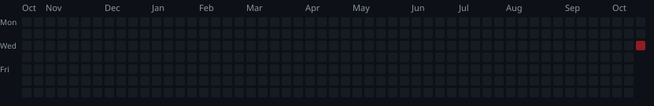

---

### About

🧠 Learning cyber the long way, not collecting job titles.

🐍 Python is the part I'm actually getting better at. The rest of the path is still open.

🎮 When the learning loses, the PS5 wins.

🤫 Public version ends there.

---

### Tech stack

 

 

---

### When I'm not working

---

### GitHub stats

<table>
  <tr>
    <td align="center" width="50%">
      
    </td>
    <td align="center" width="50%">
      
    </td>
  </tr>
</table>

---

### Contribution board

 

> Read the source until it breaks.

---

<picture>
  <source media="(prefers-color-scheme: dark)" srcset="https://raw.githubusercontent.com/ponzidon/ponzidon/output/github-contribution-grid-snake-dark.svg" />
  <source media="(prefers-color-scheme: light)" srcset="https://raw.githubusercontent.com/ponzidon/ponzidon/output/github-contribution-grid-snake.svg" />
  
</picture>

